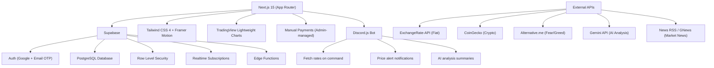
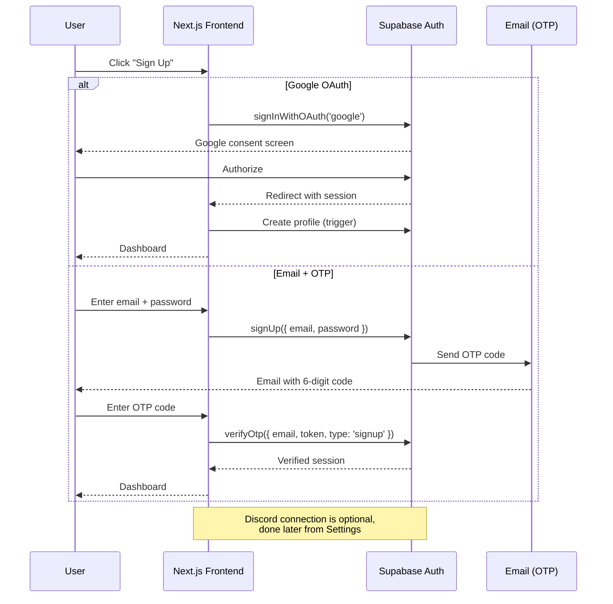
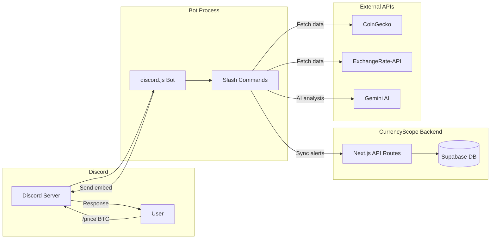
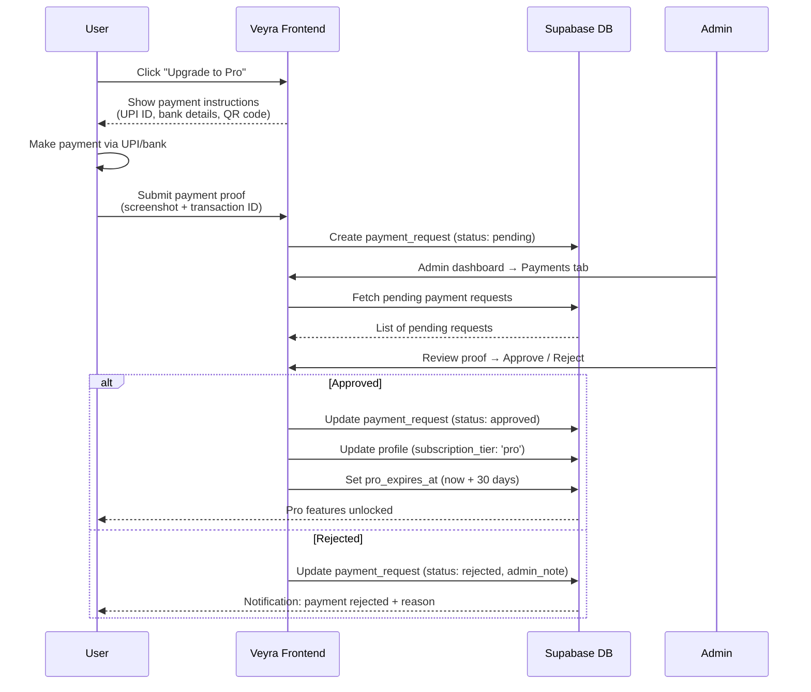
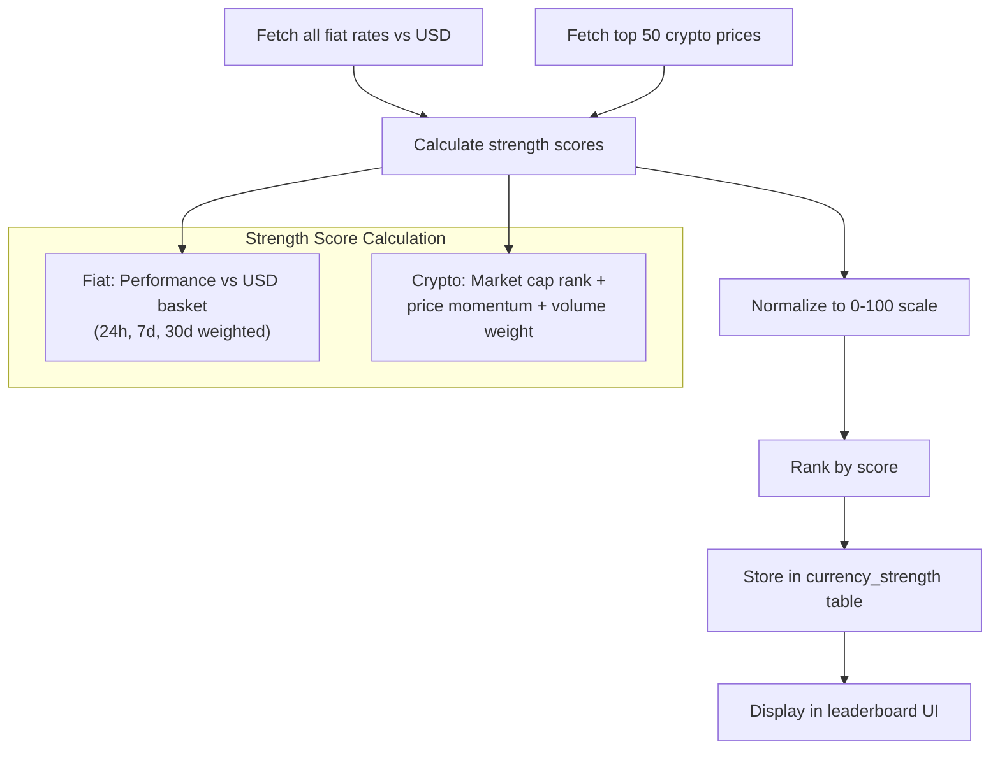
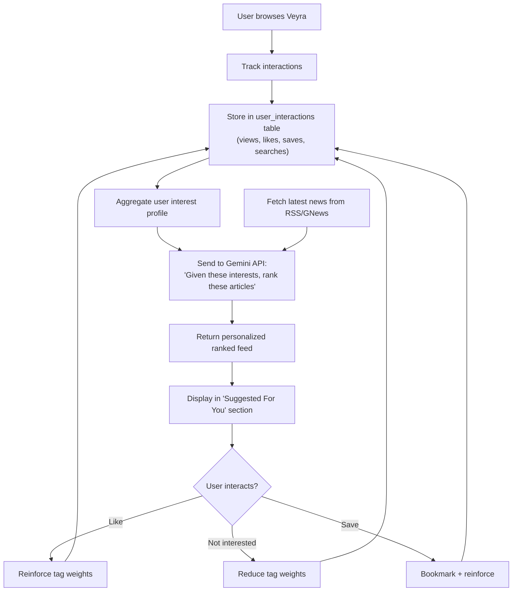

# Veyra — Premium Currency & Crypto Analysis Platform

## Goal Description

Build **Veyra**, a fluid, modern currency viewer and crypto analysis website. The platform provides real-time fiat exchange rates, cryptocurrency market data, **currency strength leaderboards**, personalized news feeds, AI-powered analysis (paid tier at ₹200/mo), Discord bot connectivity, and a full admin dashboard — all backed by Supabase and deployed on Vercel, styled with a clean **white-black-blue** design system with dynamic blur and glassmorphism.

> [!IMPORTANT]
> **This is a view-only platform.** No buying, selling, swapping, or trading. The app is purely for viewing rates, analyzing trends, comparing currency strength, and getting AI insights.

---

## Reference Design Analysis

The uploaded images inform our design direction:

````carousel

<!-- slide -->

<!-- slide -->

<!-- slide -->

````

**Design takeaways we'll go *beyond*:**
- Image 3's dark dashboard layout → we'll use a **deep dark base** with **blue accent tones** and **frosted glass cards** (NO orange/teal/purple/neon)
- Image 4's AI summary panel + calendar → we'll build a richer **AI Analysis chatbox** with streaming responses
- All images' chart styles → we'll use **TradingView lightweight charts** + custom animated sparklines
- We add: **dynamic animated backgrounds**, **backdrop-blur glassmorphism on every card**, **fluid page transitions**, and **micro-interactions**
- **Color palette is strictly: white, black, grays, and blue** — no AI-looking purple/neon/gradient rainbows

---

## Confirmed Decisions

| Question | Answer |
|---|---|
| **App name** | **Veyra** |
| **Payment** | **Manual payments** (admin-managed, no Stripe — admin verifies and activates Pro) |
| **AI provider** | **Gemini API** |
| **Pricing** | **₹200/month** for Pro (AI Analysis) tier |
| **Email OTP** | To be decided later |
| **Discord bot hosting** | To be decided later |
| **Deployment** | **Vercel** (MCP connected) |

> [!WARNING]
> **Discord Bot**: You'll need to create a Discord Application at [discord.com/developers](https://discord.com/developers) and provide the Bot Token, Client ID, and Client Secret. The plan includes a full Discord bot (`discord.js`) that runs as a separate process.

---

## Open Questions

> [!IMPORTANT]
> 1. **Email provider for OTP verification**: Supabase built-in (limited to 4/hour free) or custom SMTP like Resend? We can decide during implementation.
> 2. **Discord bot hosting**: Webhook-based inside Next.js or separate process? We can decide later.

---

## Standout Features

| Feature | Description |
|---|---|
| 🏆 **Currency Strength Leaderboard** | Ranked list of strongest to weakest currencies based on performance vs a basket; users can compare any two currencies head-to-head |
| 🆚 **Currency vs Currency Comparison** | Select 2+ currencies, see side-by-side strength bars, historical chart overlay, and "which is stronger" verdict |
| 📰 **Personalized News Feed** | Users follow topics (crypto, forex, specific coins); app tracks what they read/like and uses Gemini to suggest news matching their interests and mood |
| 🌐 **Live Currency Heatmap** | Interactive world map showing currency strength with color-coded regions |
| 📊 **Fear & Greed Index** | Real-time crypto sentiment gauge (Alternative.me API) with historical chart |
| ⚡ **Real-time Price Ticker** | Animated scrolling ticker bar at the top showing live prices |
| 🔔 **Price Alerts** | Users set target prices; get notified via Discord bot + in-app notifications |
| 📈 **Multi-currency Comparison** | Compare up to 5 currencies/cryptos on a single chart |
| 🏅 **Top Movers** | Daily/weekly top gainers and losers for both fiat and crypto |
| 🗓️ **Economic Calendar** | Upcoming events affecting currency markets |
| 💰 **Global Tax News** | Tax policy changes affecting international currency markets |
| 🤖 **AI Chat** (Paid) | "Ask anything about markets" — conversational AI with chart generation |
| 📊 **AI Reports** (Paid) | Auto-generated daily/weekly market analysis PDFs |
| ⭐ **Watchlist** | Personal watchlist with sparkline charts and alerts |
| 🏷️ **Currency Converter** | Quick conversion tool (view only, no actual exchange) |
| 🎨 **Theme Toggle** | Dark/Light mode with smooth transitions — white-black-blue palette |

---

## Tech Stack



| Layer | Technology |
|---|---|
| **Framework** | Next.js 15 (App Router, Server Components, Server Actions) |
| **Database** | Supabase PostgreSQL (via MCP) |
| **Auth** | Supabase Auth (Google OAuth + Email OTP verification) |
| **Styling** | Tailwind CSS 4 + custom glassmorphism utilities |
| **Animations** | Framer Motion + CSS animations |
| **Charts** | TradingView Lightweight Charts + Recharts (for dashboards) |
| **Payments** | Manual (admin-managed via dashboard — user requests upgrade, admin verifies payment and activates Pro) |
| **Discord** | discord.js v14 (hosting TBD) |
| **AI** | Gemini API (for paid-tier analysis + news personalization) |
| **Fiat Rates** | ExchangeRate-API (free tier, 160+ currencies) |
| **Crypto Data** | CoinGecko API (free demo tier, 10k+ coins) |
| **Sentiment** | Alternative.me Fear & Greed Index API |
| **News** | GNews API / RSS feeds (economic, crypto, tax, market news) |
| **Deployment** | Vercel (frontend, MCP connected) + Discord bot hosting TBD |

---

## Proposed Changes

### 1. Project Scaffolding & Configuration

#### [NEW] Project initialization

```bash
npx create-next-app@latest . --typescript --tailwind --eslint --app --src-dir --import-alias "@/*"
```

#### [NEW] Key dependencies

```json
{
  "dependencies": {
    "next": "^15",
    "react": "^19",
    "@supabase/supabase-js": "^2",
    "@supabase/ssr": "^0.5",

    "framer-motion": "^11",
    "lightweight-charts": "^4",
    "recharts": "^2",
    "lucide-react": "^0.400",
    "date-fns": "^4",
    "zustand": "^5",
    "zod": "^3",
    "sonner": "^1",
    "next-themes": "^0.4",
    "@tanstack/react-query": "^5",
    "clsx": "^2",
    "tailwind-merge": "^2"
  },
  "devDependencies": {
    "@types/node": "^22",
    "@types/react": "^19",
    "typescript": "^5"
  }
}
```

#### [NEW] Discord bot (separate package)

```json
{
  "name": "currencyscope-discord-bot",
  "dependencies": {
    "discord.js": "^14",
    "dotenv": "^16",
    "node-fetch": "^3"
  }
}
```

#### [NEW] `.env.local`

```env
# Supabase
NEXT_PUBLIC_SUPABASE_URL=
NEXT_PUBLIC_SUPABASE_ANON_KEY=
SUPABASE_SERVICE_ROLE_KEY=

# Discord
DISCORD_BOT_TOKEN=
DISCORD_CLIENT_ID=
DISCORD_CLIENT_SECRET=
NEXT_PUBLIC_DISCORD_INVITE_URL=

# APIs
COINGECKO_API_KEY=
EXCHANGERATE_API_KEY=
GEMINI_API_KEY=

# App
NEXT_PUBLIC_SITE_URL=http://localhost:3000
```

---

### 2. Supabase Database Schema

> [!NOTE]
> All tables use UUID primary keys, have RLS enabled, and follow Supabase Postgres best practices. Migrations will be generated via `supabase db pull`.

#### [NEW] Core tables (via Supabase MCP `execute_sql`)

```sql
-- ============================================
-- 1. USER PROFILES (extends auth.users)
-- ============================================
CREATE TABLE public.profiles (
  id UUID PRIMARY KEY REFERENCES auth.users(id) ON DELETE CASCADE,
  email TEXT NOT NULL,
  full_name TEXT,
  avatar_url TEXT,
  discord_id TEXT UNIQUE,
  discord_username TEXT,
  discord_connected_at TIMESTAMPTZ,
  subscription_tier TEXT NOT NULL DEFAULT 'free' CHECK (subscription_tier IN ('free', 'pro')),
  is_admin BOOLEAN NOT NULL DEFAULT FALSE,
  email_verified BOOLEAN NOT NULL DEFAULT FALSE,
  created_at TIMESTAMPTZ NOT NULL DEFAULT NOW(),
  updated_at TIMESTAMPTZ NOT NULL DEFAULT NOW()
);

ALTER TABLE public.profiles ENABLE ROW LEVEL SECURITY;

CREATE POLICY "Users can view own profile"
  ON public.profiles FOR SELECT
  TO authenticated
  USING ((SELECT auth.uid()) = id);

CREATE POLICY "Users can update own profile"
  ON public.profiles FOR UPDATE
  TO authenticated
  USING ((SELECT auth.uid()) = id)
  WITH CHECK ((SELECT auth.uid()) = id);

CREATE POLICY "Admins can view all profiles"
  ON public.profiles FOR SELECT
  TO authenticated
  USING (
    EXISTS (SELECT 1 FROM public.profiles WHERE id = (SELECT auth.uid()) AND is_admin = TRUE)
  );

-- Auto-create profile on signup
CREATE OR REPLACE FUNCTION public.handle_new_user()
RETURNS TRIGGER
LANGUAGE plpgsql
SECURITY DEFINER
SET search_path = ''
AS $$
BEGIN
  INSERT INTO public.profiles (id, email, full_name, avatar_url)
  VALUES (
    NEW.id,
    NEW.email,
    COALESCE(NEW.raw_user_meta_data->>'full_name', NEW.raw_user_meta_data->>'name', ''),
    COALESCE(NEW.raw_user_meta_data->>'avatar_url', '')
  );
  RETURN NEW;
END;
$$;

CREATE TRIGGER on_auth_user_created
  AFTER INSERT ON auth.users
  FOR EACH ROW EXECUTE FUNCTION public.handle_new_user();

-- ============================================
-- 2. MANUAL PAYMENT REQUESTS (replaces Stripe)
-- ============================================
CREATE TABLE public.payment_requests (
  id UUID PRIMARY KEY DEFAULT gen_random_uuid(),
  user_id UUID NOT NULL REFERENCES auth.users(id) ON DELETE CASCADE,
  amount_inr NUMERIC NOT NULL DEFAULT 200,
  plan TEXT NOT NULL DEFAULT 'pro_monthly',
  status TEXT NOT NULL DEFAULT 'pending' CHECK (status IN ('pending', 'approved', 'rejected', 'expired')),
  payment_proof_url TEXT,           -- user uploads screenshot/proof
  payment_method TEXT,              -- 'upi', 'bank_transfer', etc.
  transaction_id TEXT,              -- user-provided transaction ID
  admin_note TEXT,                  -- admin can leave a note
  reviewed_by UUID REFERENCES auth.users(id),
  reviewed_at TIMESTAMPTZ,
  pro_expires_at TIMESTAMPTZ,      -- when the Pro period ends
  created_at TIMESTAMPTZ NOT NULL DEFAULT NOW()
);

ALTER TABLE public.payment_requests ENABLE ROW LEVEL SECURITY;

CREATE POLICY "Users can view own payment requests"
  ON public.payment_requests FOR SELECT
  TO authenticated
  USING ((SELECT auth.uid()) = user_id);

CREATE POLICY "Users can create payment requests"
  ON public.payment_requests FOR INSERT
  TO authenticated
  WITH CHECK ((SELECT auth.uid()) = user_id);

CREATE POLICY "Admins can manage all payment requests"
  ON public.payment_requests FOR ALL
  TO authenticated
  USING (
    EXISTS (SELECT 1 FROM public.profiles WHERE id = (SELECT auth.uid()) AND is_admin = TRUE)
  );

-- ============================================
-- 3. WATCHLISTS
-- ============================================
CREATE TABLE public.watchlists (
  id UUID PRIMARY KEY DEFAULT gen_random_uuid(),
  user_id UUID NOT NULL REFERENCES auth.users(id) ON DELETE CASCADE,
  symbol TEXT NOT NULL,         -- e.g., 'BTC', 'USD', 'EUR'
  asset_type TEXT NOT NULL CHECK (asset_type IN ('crypto', 'fiat')),
  added_at TIMESTAMPTZ NOT NULL DEFAULT NOW(),
  UNIQUE(user_id, symbol, asset_type)
);

ALTER TABLE public.watchlists ENABLE ROW LEVEL SECURITY;

CREATE POLICY "Users manage own watchlist"
  ON public.watchlists FOR ALL
  TO authenticated
  USING ((SELECT auth.uid()) = user_id)
  WITH CHECK ((SELECT auth.uid()) = user_id);

-- ============================================
-- 4. PRICE ALERTS
-- ============================================
CREATE TABLE public.price_alerts (
  id UUID PRIMARY KEY DEFAULT gen_random_uuid(),
  user_id UUID NOT NULL REFERENCES auth.users(id) ON DELETE CASCADE,
  symbol TEXT NOT NULL,
  asset_type TEXT NOT NULL CHECK (asset_type IN ('crypto', 'fiat')),
  target_price NUMERIC NOT NULL,
  direction TEXT NOT NULL CHECK (direction IN ('above', 'below')),
  is_triggered BOOLEAN NOT NULL DEFAULT FALSE,
  triggered_at TIMESTAMPTZ,
  notify_discord BOOLEAN NOT NULL DEFAULT FALSE,
  created_at TIMESTAMPTZ NOT NULL DEFAULT NOW()
);

ALTER TABLE public.price_alerts ENABLE ROW LEVEL SECURITY;

CREATE POLICY "Users manage own alerts"
  ON public.price_alerts FOR ALL
  TO authenticated
  USING ((SELECT auth.uid()) = user_id)
  WITH CHECK ((SELECT auth.uid()) = user_id);

-- ============================================
-- 5. AI ANALYSIS HISTORY (Pro users only)
-- ============================================
CREATE TABLE public.ai_analyses (
  id UUID PRIMARY KEY DEFAULT gen_random_uuid(),
  user_id UUID NOT NULL REFERENCES auth.users(id) ON DELETE CASCADE,
  query TEXT NOT NULL,
  response TEXT NOT NULL,
  tokens_used INTEGER DEFAULT 0,
  created_at TIMESTAMPTZ NOT NULL DEFAULT NOW()
);

ALTER TABLE public.ai_analyses ENABLE ROW LEVEL SECURITY;

CREATE POLICY "Pro users can view own analyses"
  ON public.ai_analyses FOR SELECT
  TO authenticated
  USING (
    (SELECT auth.uid()) = user_id
    AND EXISTS (
      SELECT 1 FROM public.profiles
      WHERE id = (SELECT auth.uid())
      AND subscription_tier = 'pro'
    )
  );

-- ============================================
-- 6. NEWS PREFERENCES & FOLLOWING
-- ============================================
CREATE TABLE public.news_categories (
  id UUID PRIMARY KEY DEFAULT gen_random_uuid(),
  slug TEXT NOT NULL UNIQUE,       -- 'crypto', 'forex', 'taxes', 'economic', 'bitcoin', 'ethereum', etc.
  label TEXT NOT NULL,
  category_type TEXT NOT NULL CHECK (category_type IN ('topic', 'asset', 'region')),
  icon TEXT,                       -- lucide icon name
  created_at TIMESTAMPTZ NOT NULL DEFAULT NOW()
);

-- No RLS — public read
ALTER TABLE public.news_categories ENABLE ROW LEVEL SECURITY;
CREATE POLICY "Anyone can read categories"
  ON public.news_categories FOR SELECT
  TO authenticated USING (TRUE);

CREATE TABLE public.user_news_follows (
  id UUID PRIMARY KEY DEFAULT gen_random_uuid(),
  user_id UUID NOT NULL REFERENCES auth.users(id) ON DELETE CASCADE,
  category_id UUID NOT NULL REFERENCES public.news_categories(id) ON DELETE CASCADE,
  created_at TIMESTAMPTZ NOT NULL DEFAULT NOW(),
  UNIQUE(user_id, category_id)
);

ALTER TABLE public.user_news_follows ENABLE ROW LEVEL SECURITY;
CREATE POLICY "Users manage own follows"
  ON public.user_news_follows FOR ALL
  TO authenticated
  USING ((SELECT auth.uid()) = user_id)
  WITH CHECK ((SELECT auth.uid()) = user_id);

-- ============================================
-- 7. USER INTERACTIONS (for personalized suggestions)
-- ============================================
CREATE TABLE public.user_interactions (
  id UUID PRIMARY KEY DEFAULT gen_random_uuid(),
  user_id UUID NOT NULL REFERENCES auth.users(id) ON DELETE CASCADE,
  interaction_type TEXT NOT NULL CHECK (interaction_type IN ('view', 'like', 'save', 'search')),
  content_type TEXT NOT NULL,       -- 'news', 'crypto', 'currency', 'analysis'
  content_id TEXT,                  -- news article ID, coin ID, currency code
  content_title TEXT,               -- for display/debugging
  tags TEXT[],                      -- ['bitcoin', 'bullish', 'regulation']
  created_at TIMESTAMPTZ NOT NULL DEFAULT NOW()
);

ALTER TABLE public.user_interactions ENABLE ROW LEVEL SECURITY;
CREATE POLICY "Users manage own interactions"
  ON public.user_interactions FOR ALL
  TO authenticated
  USING ((SELECT auth.uid()) = user_id)
  WITH CHECK ((SELECT auth.uid()) = user_id);

-- Index for fast personalized queries
CREATE INDEX idx_user_interactions_user_type
  ON public.user_interactions (user_id, interaction_type, created_at DESC);

CREATE INDEX idx_user_interactions_tags
  ON public.user_interactions USING GIN (tags);

-- ============================================
-- 8. CURRENCY STRENGTH LEADERBOARD
-- ============================================
CREATE TABLE public.currency_strength (
  id UUID PRIMARY KEY DEFAULT gen_random_uuid(),
  currency_code TEXT NOT NULL,      -- 'USD', 'EUR', 'BTC', etc.
  asset_type TEXT NOT NULL CHECK (asset_type IN ('crypto', 'fiat')),
  strength_score NUMERIC NOT NULL,  -- 0-100 normalized score
  rank INTEGER NOT NULL,
  change_24h NUMERIC,               -- strength change in 24h
  change_7d NUMERIC,                -- strength change in 7d
  vs_usd_rate NUMERIC,
  calculated_at TIMESTAMPTZ NOT NULL DEFAULT NOW(),
  UNIQUE(currency_code, asset_type, calculated_at)
);

-- No RLS needed for cached leaderboard data — read via service role
ALTER TABLE public.currency_strength ENABLE ROW LEVEL SECURITY;
CREATE POLICY "Public read for strength data"
  ON public.currency_strength FOR SELECT
  TO authenticated USING (TRUE);

-- ============================================
-- 9. API KEYS MANAGEMENT (Admin)
-- ============================================
CREATE TABLE public.api_configs (
  id UUID PRIMARY KEY DEFAULT gen_random_uuid(),
  service_name TEXT NOT NULL UNIQUE,  -- 'coingecko', 'exchangerate', 'gemini', 'discord'
  api_key_encrypted TEXT,
  is_active BOOLEAN NOT NULL DEFAULT TRUE,
  rate_limit_per_min INTEGER,
  last_checked_at TIMESTAMPTZ,
  status TEXT DEFAULT 'healthy',
  created_at TIMESTAMPTZ NOT NULL DEFAULT NOW(),
  updated_at TIMESTAMPTZ NOT NULL DEFAULT NOW()
);

ALTER TABLE public.api_configs ENABLE ROW LEVEL SECURITY;

CREATE POLICY "Only admins can manage API configs"
  ON public.api_configs FOR ALL
  TO authenticated
  USING (
    EXISTS (SELECT 1 FROM public.profiles WHERE id = (SELECT auth.uid()) AND is_admin = TRUE)
  );

-- ============================================
-- 10. ADMIN AUDIT LOG
-- ============================================
CREATE TABLE public.admin_audit_log (
  id UUID PRIMARY KEY DEFAULT gen_random_uuid(),
  admin_id UUID NOT NULL REFERENCES auth.users(id),
  action TEXT NOT NULL,
  details JSONB DEFAULT '{}',
  created_at TIMESTAMPTZ NOT NULL DEFAULT NOW()
);

ALTER TABLE public.admin_audit_log ENABLE ROW LEVEL SECURITY;

CREATE POLICY "Only admins can view audit log"
  ON public.admin_audit_log FOR SELECT
  TO authenticated
  USING (
    EXISTS (SELECT 1 FROM public.profiles WHERE id = (SELECT auth.uid()) AND is_admin = TRUE)
  );

-- ============================================
-- 11. CACHED MARKET DATA (server-side cache)
-- ============================================
CREATE TABLE public.market_cache (
  id TEXT PRIMARY KEY,  -- e.g., 'crypto_top100', 'fiat_rates', 'fear_greed'
  data JSONB NOT NULL,
  fetched_at TIMESTAMPTZ NOT NULL DEFAULT NOW(),
  expires_at TIMESTAMPTZ NOT NULL
);

ALTER TABLE public.market_cache ENABLE ROW LEVEL SECURITY;

CREATE POLICY "Public read for cached data"
  ON public.market_cache FOR SELECT
  TO authenticated
  USING (TRUE);

-- ============================================
-- 12. SAVED / BOOKMARKED NEWS
-- ============================================
CREATE TABLE public.saved_news (
  id UUID PRIMARY KEY DEFAULT gen_random_uuid(),
  user_id UUID NOT NULL REFERENCES auth.users(id) ON DELETE CASCADE,
  article_url TEXT NOT NULL,
  article_title TEXT NOT NULL,
  article_source TEXT,
  article_image TEXT,
  article_summary TEXT,
  tags TEXT[],
  saved_at TIMESTAMPTZ NOT NULL DEFAULT NOW(),
  UNIQUE(user_id, article_url)
);

ALTER TABLE public.saved_news ENABLE ROW LEVEL SECURITY;
CREATE POLICY "Users manage own saved news"
  ON public.saved_news FOR ALL
  TO authenticated
  USING ((SELECT auth.uid()) = user_id)
  WITH CHECK ((SELECT auth.uid()) = user_id);
```

---

### 3. File Structure

```
src/
├── app/
│   ├── (auth)/
│   │   ├── login/page.tsx              # Login page (Google + Email)
│   │   ├── register/page.tsx           # Registration page
│   │   ├── verify-email/page.tsx       # OTP verification page
│   │   └── layout.tsx                  # Auth layout (centered, glassmorphic card)
│   ├── (dashboard)/
│   │   ├── layout.tsx                  # Dashboard layout (sidebar + topbar + ticker)
│   │   ├── dashboard/
│   │   │   ├── home/page.tsx           # HOME — overview with followed currencies bar graph,
│   │   │   │                           #   economic news, global taxes, market news, 
│   │   │   │                           #   personalized feed, top movers
│   │   │   ├── currencies/
│   │   │   │   ├── page.tsx            # All fiat currencies list + strength ranking
│   │   │   │   └── [code]/page.tsx     # Individual currency detail + strength vs others
│   │   │   ├── crypto/
│   │   │   │   ├── page.tsx            # All crypto list (top 100+) + leaderboard
│   │   │   │   └── [id]/page.tsx       # Individual crypto detail
│   │   │   ├── leaderboard/page.tsx    # Currency Strength Leaderboard (fiat + crypto tabs)
│   │   │   ├── compare/page.tsx        # Currency vs Currency — head-to-head comparison
│   │   │   ├── converter/page.tsx      # Currency converter (view rates)
│   │   │   ├── heatmap/page.tsx        # World currency heatmap
│   │   │   ├── watchlist/page.tsx      # User's watchlist
│   │   │   ├── alerts/page.tsx         # Price alerts management
│   │   │   ├── news/
│   │   │   │   ├── page.tsx            # Personalized news feed (follow/unfollow topics)
│   │   │   │   ├── saved/page.tsx      # Saved/bookmarked articles
│   │   │   │   └── [category]/page.tsx # News by category (crypto, forex, taxes, economic)
│   │   │   ├── ai-analysis/page.tsx    # AI Analysis (Pro only, with paywall)
│   │   │   └── settings/
│   │   │       ├── page.tsx            # General settings
│   │   │       ├── discord/page.tsx    # Discord connection
│   │   │       └── subscription/page.tsx  # Subscription management + upgrade request
│   ├── (admin)/
│   │   ├── layout.tsx                  # Admin layout (admin sidebar)
│   │   ├── admin/
│   │   │   ├── page.tsx                # Admin overview/stats
│   │   │   ├── users/page.tsx          # User management
│   │   │   ├── payments/page.tsx       # Payment request management (approve/reject)
│   │   │   ├── api-keys/page.tsx       # API key management + health checks
│   │   │   ├── discord/page.tsx        # Discord connections overview
│   │   │   └── audit-log/page.tsx      # Admin activity log
│   ├── (legal)/
│   │   ├── privacy/page.tsx            # Privacy Policy
│   │   ├── terms/page.tsx              # Terms & Conditions
│   │   └── layout.tsx                  # Clean legal layout
│   ├── api/
│   │   ├── auth/
│   │   │   ├── callback/route.ts       # Supabase auth callback
│   │   │   └── discord/route.ts        # Discord OAuth callback
│   │   ├── market/
│   │   │   ├── crypto/route.ts         # Cached crypto data endpoint
│   │   │   ├── fiat/route.ts           # Cached fiat rates endpoint
│   │   │   ├── fear-greed/route.ts     # Fear & Greed index
│   │   │   ├── strength/route.ts       # Currency strength leaderboard data
│   │   │   └── news/route.ts           # Aggregated news endpoint
│   │   ├── ai/
│   │   │   └── analyze/route.ts        # AI analysis endpoint (Pro only)
│   │   ├── user/
│   │   │   ├── interactions/route.ts   # Track user interactions (views, likes)
│   │   │   ├── suggestions/route.ts    # AI-powered news suggestions
│   │   │   └── payment-request/route.ts # Submit payment upgrade request
│   │   ├── admin/
│   │   │   ├── approve-payment/route.ts # Admin approve/reject payment
│   │   │   └── manage-user/route.ts     # Admin user management actions
│   │   └── discord/
│   │       └── bot-status/route.ts     # Discord bot status check
│   ├── layout.tsx                      # Root layout (providers, fonts, theme)
│   ├── page.tsx                        # Landing page (public)
│   └── globals.css                     # Global styles + glassmorphism utilities
├── components/
│   ├── ui/                             # Reusable UI primitives
│   │   ├── glass-card.tsx              # Glassmorphism card component
│   │   ├── gradient-background.tsx     # Animated subtle BG (blue tones only)
│   │   ├── animated-counter.tsx        # Number animation component
│   │   ├── sparkline.tsx               # Mini sparkline chart
│   │   ├── price-ticker.tsx            # Scrolling price ticker
│   │   ├── theme-toggle.tsx            # Dark/Light mode toggle
│   │   ├── loading-skeleton.tsx        # Skeleton loaders
│   │   ├── sidebar.tsx                 # Navigation sidebar
│   │   ├── topbar.tsx                  # Top navigation bar
│   │   ├── modal.tsx                   # Modal component
│   │   ├── button.tsx                  # Button variants (blue primary)
│   │   ├── input.tsx                   # Input with floating label
│   │   ├── badge.tsx                   # Status badges
│   │   ├── dropdown.tsx                # Dropdown menu
│   │   ├── tabs.tsx                    # Tab switcher
│   │   └── data-table.tsx              # Sortable/filterable data table
│   ├── charts/
│   │   ├── tradingview-chart.tsx        # TradingView lightweight chart
│   │   ├── area-chart.tsx              # Area chart (Recharts)
│   │   ├── bar-chart.tsx               # Bar chart for strength comparison
│   │   ├── candlestick-chart.tsx       # Candlestick chart
│   │   ├── fear-greed-gauge.tsx        # Circular gauge component
│   │   ├── heatmap-chart.tsx           # World heatmap
│   │   ├── strength-bar.tsx            # Horizontal strength bar (0-100)
│   │   └── comparison-chart.tsx        # Multi-line comparison
│   ├── dashboard/
│   │   ├── home/
│   │   │   ├── followed-currencies.tsx # Bar graph of user's followed currencies
│   │   │   ├── economic-news.tsx       # Economic news feed widget
│   │   │   ├── global-taxes.tsx        # Global tax news widget
│   │   │   ├── market-news.tsx         # Market news feed widget
│   │   │   ├── personalized-feed.tsx   # AI-suggested news based on user behavior
│   │   │   └── quick-stats.tsx         # Top stats cards (fear/greed, top mover, etc.)
│   │   ├── market-overview.tsx         # Top cards (BTC, ETH, top movers)
│   │   ├── currency-list.tsx           # Searchable currency table with strength
│   │   ├── crypto-list.tsx             # Crypto market table with leaderboard
│   │   ├── leaderboard-table.tsx       # Ranked strength leaderboard
│   │   ├── currency-compare.tsx        # Head-to-head comparison widget
│   │   ├── watchlist-panel.tsx         # Watchlist widget
│   │   ├── news-card.tsx               # Individual news article card
│   │   ├── news-follow-button.tsx      # Follow/unfollow topic button
│   │   ├── converter-widget.tsx        # Quick converter
│   │   └── top-movers.tsx              # Gainers/losers cards
│   ├── ai/
│   │   ├── ai-chat.tsx                 # AI chat interface
│   │   ├── ai-report.tsx               # AI report viewer
│   │   └── paywall-gate.tsx            # Paywall overlay for free users
│   ├── auth/
│   │   ├── login-form.tsx              # Login form component
│   │   ├── register-form.tsx           # Register form component
│   │   ├── otp-input.tsx               # 6-digit OTP input
│   │   ├── google-button.tsx           # Google sign-in button
│   │   └── discord-connect.tsx         # Discord OAuth connect button
│   └── admin/
│       ├── admin-sidebar.tsx           # Admin navigation
│       ├── user-table.tsx              # User management table
│       ├── payment-requests-table.tsx  # Payment approval table
│       ├── api-health-card.tsx         # API health status cards
│       └── stats-cards.tsx             # Admin statistics
├── lib/
│   ├── supabase/
│   │   ├── client.ts                   # Browser Supabase client
│   │   ├── server.ts                   # Server-side Supabase client
│   │   ├── admin.ts                    # Service role Supabase client
│   │   └── middleware.ts               # Auth middleware
│   ├── api/
│   │   ├── coingecko.ts                # CoinGecko API wrapper
│   │   ├── exchange-rates.ts           # ExchangeRate-API wrapper
│   │   ├── fear-greed.ts               # Fear & Greed API wrapper
│   │   ├── news.ts                     # News aggregator (GNews + RSS)
│   │   └── strength.ts                 # Currency strength calculator
│   ├── ai/
│   │   ├── gemini.ts                   # Gemini API client for analysis
│   │   └── suggestions.ts             # AI-powered news suggestion engine
│   ├── utils.ts                        # General utilities (cn, formatters)
│   └── constants.ts                    # App constants, currency lists
├── hooks/
│   ├── use-market-data.ts              # React Query hooks for market data
│   ├── use-auth.ts                     # Auth state hook
│   ├── use-subscription.ts             # Subscription status hook
│   ├── use-news.ts                     # News feed + follow hooks
│   ├── use-interactions.ts             # Track user interactions
│   └── use-theme.ts                    # Theme management hook
├── stores/
│   └── app-store.ts                    # Zustand global store
├── types/
│   ├── database.ts                     # Supabase generated types
│   ├── market.ts                       # Market data types
│   └── api.ts                          # API response types
└── middleware.ts                        # Next.js middleware (auth redirect)

discord-bot/                             # Separate Discord bot
├── package.json
├── src/
│   ├── index.ts                        # Bot entry point
│   ├── commands/
│   │   ├── price.ts                    # /price BTC — get crypto price
│   │   ├── rate.ts                     # /rate USD EUR — exchange rate
│   │   ├── alert.ts                    # /alert BTC 100000 above
│   │   ├── watchlist.ts                # /watchlist — show user's watchlist
│   │   ├── fear-greed.ts               # /sentiment — fear & greed index
│   │   ├── leaderboard.ts             # /leaderboard — top strongest currencies
│   │   └── analyze.ts                  # /analyze BTC — AI analysis (Pro)
│   ├── events/
│   │   └── ready.ts                    # Bot ready event
│   └── utils/
│       ├── api.ts                      # API helpers
│       └── embeds.ts                   # Discord embed builders
└── tsconfig.json
```

---

### 4. UI / Design System

#### Veyra Design System — White, Black, Blue

> [!IMPORTANT]
> **Strict color palette: White · Black · Grays · Blue.** No purple, neon, orange, teal, or any "AI-looking" colors. The only accent is blue. Green/red are reserved for gain/loss indicators only.

```css
/* globals.css — Veyra core design */

/* Subtle animated background — blue tones only */
.veyra-bg {
  background: 
    radial-gradient(ellipse at 20% 50%, rgba(59, 130, 246, 0.06) 0%, transparent 50%),
    radial-gradient(ellipse at 80% 20%, rgba(37, 99, 235, 0.04) 0%, transparent 50%),
    radial-gradient(ellipse at 50% 80%, rgba(96, 165, 250, 0.03) 0%, transparent 50%);
  animation: veyra-shift 25s ease-in-out infinite;
}

@keyframes veyra-shift {
  0%, 100% { background-position: 0% 0%, 100% 0%, 50% 100%; }
  50% { background-position: 100% 100%, 0% 50%, 50% 0%; }
}

/* Glass card variants — blue-tinted */
.glass {
  @apply backdrop-blur-xl bg-white/5 border border-white/10 rounded-2xl shadow-2xl;
}

.glass-light {
  @apply backdrop-blur-xl bg-white/80 border border-zinc-200 rounded-2xl shadow-md;
}

.glass-hover {
  @apply transition-all duration-300 hover:bg-white/10 hover:border-blue-500/20 hover:shadow-blue-500/5;
}

/* Fluid transitions everywhere */
* {
  @apply transition-colors duration-300;
}
```

#### Theme Toggle (Dark ↔ Light)

The theme system uses `next-themes` with:
- **Dark mode**: `#09090b` base + frosted glass cards + blue accent highlights
- **Light mode**: `#fafafa` base + light frosted glass + blue accent + subtle gray borders
- Smooth 300ms CSS transition on toggle
- **Single accent: Blue** (`#3b82f6`) — no customization needed

#### Design Tokens

```typescript
// tailwind.config.ts additions
{
  extend: {
    colors: {
      // Core palette — white, black, gray, blue only
      glass: {
        DEFAULT: 'rgba(255, 255, 255, 0.05)',
        light: 'rgba(255, 255, 255, 0.80)',
        border: 'rgba(255, 255, 255, 0.10)',
        'border-light': 'rgba(228, 228, 231, 1)', // zinc-200
      },
      accent: {
        DEFAULT: '#3b82f6',    // blue-500
        hover: '#2563eb',      // blue-600
        light: '#dbeafe',      // blue-100
        glow: 'rgba(59, 130, 246, 0.15)',
      },
      // Data colors
      gain: '#22c55e',          // green — gain only
      loss: '#ef4444',          // red — loss only
      // No purple, no neon, no orange, no teal
    },
    backdropBlur: {
      xs: '2px',
      '3xl': '64px',
    },
    boxShadow: {
      'glass': '0 8px 32px rgba(0, 0, 0, 0.12)',
      'glass-dark': '0 8px 32px rgba(0, 0, 0, 0.4)',
      'blue-glow': '0 0 40px rgba(59, 130, 246, 0.1)',
    },
    animation: {
      'ticker': 'ticker 30s linear infinite',
      'fade-in': 'fadeIn 0.5s ease-out',
      'slide-up': 'slideUp 0.4s ease-out',
      'float': 'float 6s ease-in-out infinite',
    }
  }
}
```

---

### 5. Authentication Flow



**Key auth details:**
- Supabase Auth handles Google OAuth natively
- Email signup uses Supabase's built-in OTP (magic link alternative: 6-digit code)
- Discord OAuth is a **separate** connection (not for login), linked to user profile
- Middleware protects `/dashboard/*` and `/admin/*` routes
- Admin access is checked via `profiles.is_admin` column

---

### 6. Discord Bot Architecture



**Bot Commands:**

| Command | Description | Access |
|---|---|---|
| `/price <symbol>` | Get current crypto price with 24h change | All |
| `/rate <from> <to> [amount]` | Currency exchange rate | All |
| `/top [count]` | Top gainers/losers today | All |
| `/sentiment` | Fear & Greed Index | All |
| `/watchlist` | Show your synced watchlist | Linked users |
| `/alert <symbol> <price> <above/below>` | Set price alert | Linked users |
| `/analyze <symbol>` | AI market analysis | Pro users only |
| `/link` | Link Discord to CurrencyScope account | All |

---

### 7. Manual Payment System (₹200/month)

Since payments are manual (admin-managed), here's how the flow works:



**Admin payment management features:**
- View all pending, approved, and rejected requests
- One-click approve/reject with optional admin note
- Auto-expire Pro after 30 days (cron job or on-access check)
- Payment history per user
- Revenue tracking dashboard

---

### 8. Currency Strength Leaderboard

The leaderboard is a **key differentiator**. It shows which currencies are strongest/weakest relative to a basket.



**Leaderboard page (`/dashboard/leaderboard`):**
- **Two tabs**: Fiat Currencies | Cryptocurrencies
- Ranked list with: Rank, Flag/Icon, Name, Code, Strength Score (0-100 bar), 24h Δ, 7d Δ
- Color-coded strength bars (blue gradient — darker = stronger)
- Click any currency → detail page with historical strength chart

**Currency vs Currency Compare (`/dashboard/compare`):**
- Select 2+ currencies from dropdowns
- Side-by-side strength bars
- Overlay line chart showing historical performance
- "Which is stronger" verdict with percentage difference
- Animated transition when switching currencies

---

### 9. Dashboard Home (`/dashboard/home`)

The home page is the user's personalized hub:

```
┌──────────────────────────────────────────────────────────────────┐
│  ⚡ LIVE TICKER: BTC $67,432 ↑2.1%  ETH $3,821 ↑1.4%  ...     │
├──────────────────────────────────────────────────────────────────┤
│                                                                  │
│  ┌─────────────┐ ┌─────────────┐ ┌─────────────┐ ┌───────────┐  │
│  │ Fear/Greed  │ │ Top Mover   │ │ BTC Price   │ │ Users     │  │
│  │   62        │ │ SOL ↑12.3%  │ │ $67,432     │ │ Online    │  │
│  │  ■■■■■□□□□  │ │             │ │ ↑ 2.1%      │ │ 1,234     │  │
│  └─────────────┘ └─────────────┘ └─────────────┘ └───────────┘  │
│                                                                  │
│  ┌────────────────────────────────────────────────────────────┐  │
│  │  📊 Your Followed Currencies                              │  │
│  │  ┌───┐ ┌───┐ ┌───┐ ┌───┐ ┌───┐ ┌───┐                    │  │
│  │  │USD│ │EUR│ │GBP│ │BTC│ │ETH│ │INR│  ← Bar Graph        │  │
│  │  │███│ │██ │ │██ │ │███│ │██ │ │█  │     (strength)       │  │
│  │  │███│ │██ │ │██ │ │███│ │██ │ │█  │                      │  │
│  │  └───┘ └───┘ └───┘ └───┘ └───┘ └───┘                    │  │
│  └────────────────────────────────────────────────────────────┘  │
│                                                                  │
│  ┌──────────────────────┐  ┌──────────────────────────────────┐  │
│  │  📰 Economic News    │  │  🌍 Global Tax Updates           │  │
│  │                      │  │                                  │  │
│  │  Fed holds rates     │  │  EU carbon tax update...         │  │
│  │  steady at 5.25%     │  │  India GST revision...           │  │
│  │  ───────────────     │  │  UK capital gains...             │  │
│  │  ECB signals cut     │  │  ───────────────                 │  │
│  │  in December...      │  │  US crypto tax...                │  │
│  │  ───────────────     │  │                                  │  │
│  │  [Follow] [Save]     │  │  [Follow] [Save]                │  │
│  └──────────────────────┘  └──────────────────────────────────┘  │
│                                                                  │
│  ┌──────────────────────┐  ┌──────────────────────────────────┐  │
│  │  📈 Market News      │  │  ✨ Suggested For You            │  │
│  │                      │  │  (based on your interests)       │  │
│  │  Bitcoin hits new    │  │                                  │  │
│  │  weekly high...      │  │  "Ethereum DeFi TVL rises..."   │  │
│  │  ───────────────     │  │  "USD strengthens against..."   │  │
│  │  Solana TVL...       │  │  "Gold vs Bitcoin: which..."    │  │
│  │  ───────────────     │  │                                  │  │
│  │  [Follow] [Save]     │  │  [Like] [Save] [Not interested] │  │
│  └──────────────────────┘  └──────────────────────────────────┘  │
│                                                                  │
└──────────────────────────────────────────────────────────────────┘
```

**Key features:**
- **Quick Stats Row**: Fear & Greed gauge, top mover today, BTC price, online users
- **Followed Currencies Bar Graph**: Bar chart showing strength of currencies the user follows — updates in near real-time
- **4 News Sections in a grid**:
  - Economic News (central bank decisions, GDP, inflation)
  - Global Tax Updates (international tax policy changes)
  - Market News (crypto/forex market movements)
  - Suggested For You (personalized via Gemini based on user interactions)
- Each article has **Follow** (follow the topic) and **Save** (bookmark) buttons
- Suggested section has **Like** / **Not Interested** to refine recommendations

---

### 10. Personalized News & Suggestion Engine



**How it works:**
1. Every page view, search, like, and save is tracked in `user_interactions` with tags
2. Tags are extracted from content (e.g., `['bitcoin', 'regulation', 'bullish']`)
3. Periodically (or on page load), Gemini receives the user's top interests + latest news
4. Gemini ranks and filters articles by relevance to the user's reading history
5. User feedback (like/not interested) continuously refines the suggestions

---

### 11. AI Analysis System (Pro Only — ₹200/month)

```mermaid
flowchart TD
    U[Pro User] -->|"Asks: What's the BTC outlook?"| FE[AI Chat Interface]
    FE -->|Verify subscription| AUTH{Pro User?}
    AUTH -->|No| PW[Show Paywall]
    AUTH -->|Yes| API[/api/ai/analyze]
    API -->|Fetch context| DATA[Market Data Cache]
    DATA -->|BTC price, volume, 24h, 7d, fear/greed| PROMPT[Build Prompt]
    PROMPT -->|Stream| GEMINI[Gemini API]
    GEMINI -->|Streamed response| FE
    FE -->|Display with charts| U
    API -->|Save to DB| DB[(ai_analyses)]
```

**AI Analysis Features:**
1. **Market Chat**: Ask anything about currency/crypto markets
2. **Daily Digest**: Auto-generated morning market summary
3. **Asset Deep Dive**: Detailed analysis of any asset with historical context
4. **Comparison Analysis**: "Compare BTC vs ETH performance this month"
5. **Trend Prediction**: AI-generated trend analysis with confidence scores

**Prompt engineering**: The AI gets injected with real-time market data (prices, volumes, fear/greed, top movers) as context before answering, making responses data-grounded.

---

### 12. Admin Dashboard

The admin panel at `/admin/*` provides full platform management:

```
Admin Dashboard
├── Overview
│   ├── Total users / New today / Active today
│   ├── Pro subscribers / Revenue (manual payment totals)
│   ├── API health status (all services)
│   └── Discord bot status (online/offline)
├── User Management
│   ├── Search / filter users
│   ├── View user details (subscription, discord, activity, interests)
│   ├── Grant/revoke admin access
│   └── Manual subscription override (grant/revoke Pro)
├── Payment Requests
│   ├── Pending requests with proof screenshots
│   ├── One-click Approve / Reject with admin note
│   ├── Payment history per user
│   ├── Auto-expiry tracking (30-day Pro periods)
│   └── Revenue summary (₹200/user × active Pro users)
├── API Management
│   ├── API key configuration (encrypted)
│   ├── Health check status per API
│   ├── Rate limit monitoring
│   └── Toggle APIs on/off
├── Discord Management
│   ├── Connected users list
│   ├── Bot status & uptime
│   ├── Command usage analytics
│   └── Server membership overview
└── Audit Log
    ├── All admin actions logged
    ├── Filterable by action type
    └── Exportable as CSV
```

---

### 9. Legal Pages

#### [NEW] `src/app/(legal)/privacy/page.tsx`

Privacy Policy covering:
- Data we collect: Email, name, avatar, Discord ID (if connected), browsing/interaction history (for news personalization), saved news
- Data we do NOT collect: Payment card info (manual payments), passwords (hashed by Supabase)
- How we use data: Account management, personalization, AI-powered news suggestions, interaction tracking
- Third-party services: Supabase (auth/DB), CoinGecko (market data), Discord (bot), Gemini (AI analysis + suggestions), GNews (news)
- Data retention: Account data retained until deletion; AI analysis history for 90 days; interaction data for 180 days
- User rights: Access, correction, deletion, data export
- Cookie usage: Essential only (session tokens)
- Contact information

#### [NEW] `src/app/(legal)/terms/page.tsx`

Terms & Conditions covering:
- Service description: Currency/crypto information platform (NOT financial advice)
- Account requirements: Valid email, age 13+
- Subscription terms: Pro tier at ₹200/month, manual payment, admin-verified, cancel anytime
- Acceptable use: No scraping, no abuse, no commercial redistribution
- Disclaimer: All market data is for informational purposes only, not investment advice
- Limitation of liability
- Intellectual property
- Termination policy

---

### 14. Landing Page

A stunning public landing page at `/` featuring:

1. **Hero Section**: Clean dark/light background with subtle blue radial glow + "Track Every Currency. Analyze Every Move." headline
2. **Live Ticker**: Scrolling crypto/fiat prices at the top
3. **Feature Grid**: 6 glass cards showcasing key features with blue-accent icons
4. **Leaderboard Preview**: Live mini-leaderboard showing top 5 strongest currencies
5. **Comparison Section**: Free vs Pro tier comparison table (Pro = ₹200/month for AI Analysis)
6. **Screenshots**: Dashboard preview with parallax scrolling
7. **CTA**: "Start Tracking for Free" button → `/register`
8. **Footer**: Links to Privacy Policy, Terms, Discord invite

---

### 15. Execution Plan for AI Agents

> [!TIP]
> The implementation will be executed using the `/teamwork` swarm pattern with multiple agents working in parallel. Here's the phased breakdown:

#### Phase 1 — Foundation (Agents work in parallel)

| Agent | Responsibility |
|---|---|
| **db-architect** | Set up Supabase schema (all 12 tables, RLS policies, triggers, functions, indexes) via MCP |
| **scaffolder** | Initialize Next.js project, install deps, configure Tailwind with Veyra tokens, set up file structure |
| **design-system** | Build all UI primitives (`glass-card`, `gradient-background`, `theme-toggle`, `sidebar`, `data-table`, etc.) — strictly white/black/blue |

#### Phase 2 — Core Features (Agents work in parallel)

| Agent | Responsibility |
|---|---|
| **auth-agent** | Build auth flow (login, register, OTP verify, Google OAuth, middleware, Discord connect) |
| **market-data-agent** | Build API wrappers (CoinGecko, ExchangeRate, Fear/Greed, News), caching layer, React Query hooks, strength calculator |
| **charts-agent** | Build all chart components (TradingView, area, bar, candlestick, gauge, heatmap, strength-bar, sparkline) |

#### Phase 3 — Pages & Features (Agents work in parallel)

| Agent | Responsibility |
|---|---|
| **dashboard-agent** | Build `/dashboard/home` (followed currencies bar graph, 4 news sections, quick stats), currency list, crypto list, converter, watchlist, alerts, compare |
| **leaderboard-agent** | Build leaderboard page, currency strength ranking, head-to-head comparison, strength bars |
| **news-agent** | Build personalized news system (follow/unfollow topics, interaction tracking, Gemini suggestions, saved articles) |
| **ai-agent** | Build AI analysis system (Gemini integration, chat UI, paywall gate, streaming responses) |
| **admin-agent** | Build admin dashboard (users, payment requests approve/reject, API management, Discord, audit log) |
| **discord-agent** | Build Discord bot (all commands including `/leaderboard`, embed builders, Supabase sync) |

#### Phase 4 — Polish (Agents work together)

| Agent | Responsibility |
|---|---|
| **landing-agent** | Build landing page with blue-accent animations, leaderboard preview |
| **legal-agent** | Write Privacy Policy and Terms & Conditions content |
| **payment-agent** | Manual payment flow (upgrade request form, proof upload, admin approval system) |

#### Phase 5 — Integration & Testing

| Agent | Responsibility |
|---|---|
| **integration-agent** | End-to-end flow testing, fix cross-component issues, fluid responsive design verification, Vercel deployment |

---

## Verification Plan

### Automated Tests

```bash
# Type checking
npx tsc --noEmit

# Lint
npx next lint

# Build verification
npx next build

# Supabase schema validation
supabase db advisors
```

### Manual Verification

1. **Auth Flow**: Register with email → receive OTP → verify → land on dashboard
2. **Google OAuth**: Sign in with Google → auto-create profile → dashboard
3. **Theme Toggle**: Switch dark ↔ light → all components transition smoothly
4. **Market Data**: Dashboard loads with real crypto/fiat data from APIs
5. **Charts**: TradingView charts render with live data, time period switching works
6. **Watchlist**: Add/remove items, persists across sessions
7. **Price Alerts**: Create alert, verify it stores in DB
8. **AI Analysis**: Free user sees paywall; Pro user (₹200/month, admin-approved) gets streaming AI response
9. **Admin Panel**: Admin can view all users, payment requests (approve/reject), API health
10. **Discord Bot**: `/price BTC` returns embed with current price; `/leaderboard` shows top currencies
11. **Converter**: Enter amount → see converted value in real-time
12. **Responsive**: Test on mobile (375px), tablet (768px), desktop (1440px) — fluid across all
13. **Privacy/Terms**: Legal pages render correctly with all required sections
14. **Leaderboard**: Currency strength ranked list with 0-100 bars, sortable, filterable
15. **News Personalization**: Follow topics → interaction tracked → Gemini suggests relevant articles
16. **Payment Flow**: User submits proof → admin approves → Pro activates for 30 days
17. **Color check**: Verify zero purple/neon/orange — only white, black, gray, blue throughout
